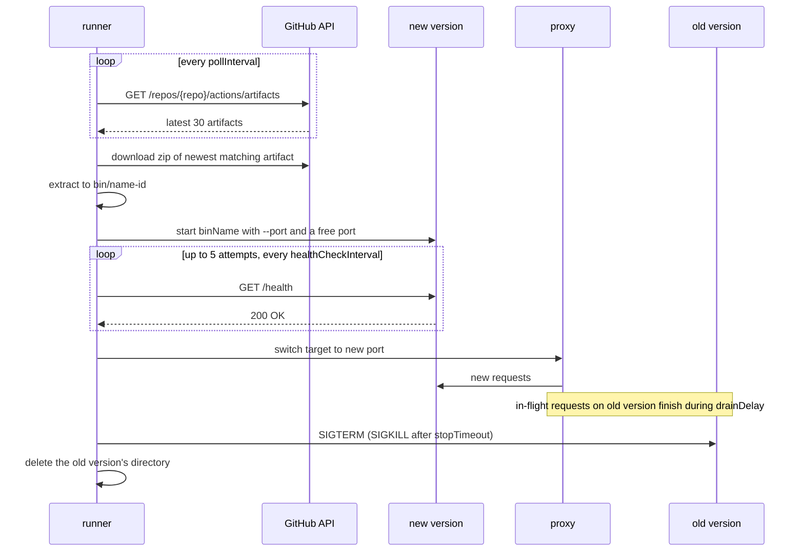

# Runner

[](https://github.com/hesenger/runner/actions/workflows/ci.yml)

Runner deploys the latest GitHub Actions build of your app to a single machine and swaps versions behind a reverse proxy without dropping requests.

It is one Go binary with no dependencies outside the standard library.

## Why

You have a small HTTP service and one VM. CI already builds a binary on every push. You want each new build running on the VM a minute later, with no failed requests during the switch, and without running Docker, a container registry or Kubernetes.

Runner pulls instead of being pushed to. It polls the GitHub Actions artifacts API, downloads the new binary, starts it next to the old one, checks `/health`, switches the proxy and stops the old process. CI needs no SSH access to the VM. The VM needs only outbound HTTPS to GitHub.

How it compares to common alternatives:

| | Zero-downtime switch | Needs Docker / registry | How a deploy starts | Hosts | What you maintain |
| --- | --- | --- | --- | --- | --- |
| systemd `Restart=` + copy binary | No: stop, then start | No | CI pushes over SSH | 1 | Unit file, deploy script |
| Kamal | Yes (kamal-proxy) | Yes | CI or laptop pushes over SSH | Many | Dockerfile, registry, `deploy.yml` |
| Caddy/nginx + scripts | Possible, if you script the upstream swap and health check | No | CI pushes over SSH | 1+ | Proxy config, deploy scripts |
| Kubernetes | Yes (rolling update, readiness probes) | Yes | `kubectl` / GitOps | Many | Cluster, manifests, registry |
| Runner | Yes | No | VM polls GitHub | 1 | `config.json` |

Runner is the right fit for one host, few apps, and a binary built by GitHub Actions. If you need multiple hosts, containers, TLS management or autoscaling, use one of the others.

## How it works



Each app in `config.json` runs its own loop:

1. **Poll.** Every `pollInterval`, list the 30 most recent artifacts of `repo` and pick the newest one that is not expired and matches `branch` and `artifactName` when set.
2. **Skip.** Do nothing if that artifact is the running version, or one that already failed.
3. **Download and extract.** Download the zip to `tmp/<name>-<id>.zip` and extract it to `bin/<name>-<id>/`. Entries outside that directory (Zip Slip) fail the artifact. The zip is always deleted.
4. **Start.** Ask the OS for a free port on `127.0.0.1` and run `bin/<name>-<id>/<binName> --port <port>`. Runner sets the execute bit, so the zip does not need to preserve it. App stdout and stderr are logged with a `[<repo>]` prefix.
5. **Health check.** Wait `healthCheckInterval`, then `GET http://127.0.0.1:<port>/health`. Up to 5 attempts, each bounded by `healthCheckTimeout`. Only `200` passes.
6. **Switch.** Point the proxy on `externalPort` at the new port. The swap is a pointer change under a `sync.RWMutex`; requests already in flight keep their backend.
7. **Drain.** Keep the old version running for `drainDelay` so in-flight requests finish.
8. **Stop old.** Send `SIGTERM` to the old process, `SIGKILL` if it is still running after `stopTimeout`, and delete its `bin/` directory.

If extraction, start or health check fails, runner stops the new process, deletes its directory, keeps serving the current version and never retries that artifact ID. A failed download is retried on the next poll. Until the first version is deployed, `externalPort` answers `503` with `Retry-After: 10`.

### Crash restart with backoff

If the running version exits on its own (crash, panic, OOM kill), runner logs the exit status and restarts the same binary after `restartBackoff`. It reuses the same internal port when it is still free, otherwise it takes a new one and switches the proxy. The restart is health checked like a deploy.

A failed restart is retried with the wait doubled each time, capped at `restartBackoffMax`, for as long as it takes. It is the only version known to work, so it is never marked as failed. A version that stays up for `restartBackoffMax` starts over from `restartBackoff` the next time it crashes. A newer artifact is still deployed while a restart is pending, and it cancels the restart. Requests fail while the app is down.

### Graceful shutdown

On `SIGINT` or `SIGTERM`, runner stops all app processes in parallel (`SIGTERM`, then `SIGKILL` after `stopTimeout`), waits until they are reaped and exits 0. A second signal exits right away. Processes runner stops itself are never restarted.

## Quick start

### 1. Install runner

```sh
go install github.com/hesenger/runner@latest
```

This needs Go 1.26.4 or newer (the `go` line in `go.mod`); the `go` command downloads it if your toolchain is older. Tagged versions also have prebuilt binaries on the [Releases page](https://github.com/hesenger/runner/releases).

### 2. Make your app follow the contract

The app must:

- listen on the port passed as `--port` (runner connects through `127.0.0.1`, so binding `127.0.0.1` is enough);
- answer `GET /health` with `200` once it is ready to serve;
- exit on `SIGTERM`. Shutting down gracefully is optional, since traffic was switched away `drainDelay` earlier.

A minimal Go app:

```go
package main

import (
	"flag"
	"fmt"
	"log"
	"net/http"
)

func main() {
	port := flag.Int("port", 8080, "port to listen on")
	flag.Parse()

	http.HandleFunc("/health", func(w http.ResponseWriter, r *http.Request) {
		w.WriteHeader(http.StatusOK)
	})
	http.HandleFunc("/", func(w http.ResponseWriter, r *http.Request) {
		fmt.Fprintln(w, "hello from myapp")
	})

	log.Fatal(http.ListenAndServe(fmt.Sprintf("127.0.0.1:%d", *port), nil))
}
```

### 3. Upload the binary as an artifact

Build for the VM's OS and architecture and upload the binary with `actions/upload-artifact`. GitHub zips it; runner extracts it and runs `binName` from the zip root.

```yaml
# .github/workflows/build.yml
name: Build

on:
  push:
    branches: [main]

jobs:
  build:
    runs-on: ubuntu-latest
    steps:
      - uses: actions/checkout@v4

      - uses: actions/setup-go@v5
        with:
          go-version-file: go.mod

      - name: Build
        run: CGO_ENABLED=0 GOOS=linux GOARCH=amd64 go build -o myapp .

      - uses: actions/upload-artifact@v4
        with:
          name: myapp
          path: myapp
          retention-days: 7
```

### 4. Create a token

Create a [fine-grained personal access token](https://github.com/settings/personal-access-tokens/new) with access to the app's repository only and the repository permission **Actions: Read-only**. Listing and downloading artifacts needs nothing else. A token is required for public repositories too, because GitHub only serves artifact downloads to authenticated requests.

### 5. Configure and run

Create `config.json` in the directory runner runs from:

```json
{
  "apps": [
    {
      "externalPort": 8000,
      "repo": "you/myapp",
      "binName": "myapp",
      "artifactName": "myapp",
      "branch": "main",
      "token": "github_pat_xxx"
    }
  ]
}
```

```sh
chmod 600 config.json
runner
```

Runner reads `config.json` from the working directory and creates `bin/` and `tmp/` there. Run it under systemd or another supervisor so it starts on boot. Its output for a first deploy and an upgrade (from a run against the e2e fake GitHub API):

```text
[MAIN] Starting app you/myapp:8000
[you/myapp] Downloading artifact myapp (1)
[you/myapp] Decompressed artifact to bin/myapp-1
[you/myapp] Starting process on port 49808
[you/myapp] New version is up on port 49808
[you/myapp] Switched proxy target to port 49808, cleaning up old process
[you/myapp] Downloading artifact myapp (2)
[you/myapp] Decompressed artifact to bin/myapp-2
[you/myapp] Starting process on port 49813
[you/myapp] New version is up on port 49813
[you/myapp] Switched proxy target to port 49813, cleaning up old process
```

After an upload, runner notices the artifact within `pollInterval` and switches no earlier than one `healthCheckInterval` after starting it. With the defaults that is 10 to 20 seconds plus download time, if the first health check passes.

## Configuration

`config.json` has top-level settings, shared by all apps, and a list of `apps`. Only `apps` is required at the top level. Durations are strings in Go syntax, such as `"500ms"`, `"2s"` or `"1m"`. Unknown fields are rejected.

| Field | Default | Meaning |
| --- | --- | --- |
| `githubApi` | `https://api.github.com` | Base URL of the GitHub REST API. The e2e test points it at a fake API. |
| `pollInterval` | `10s` | Wait between checks for a new artifact. |
| `healthCheckInterval` | `10s` | Wait before each of the 5 `GET /health` attempts on a new or restarted version. |
| `healthCheckTimeout` | `5s` | Timeout of each `GET /health` attempt. |
| `drainDelay` | `10s` | Time the old version keeps running after traffic is switched away. May be `0`. |
| `stopTimeout` | `10s` | Time an app process gets to exit after `SIGTERM` before it gets `SIGKILL`. |
| `apiTimeout` | `30s` | Timeout of each GitHub API request, and of waiting for a download's response headers. |
| `downloadTimeout` | `10m` | Timeout of each artifact download, including the zip body. |
| `restartBackoff` | `1s` | Wait before restarting a version that exited unexpectedly. Doubles after each failed restart. |
| `restartBackoffMax` | `1m` | Cap of the restart wait. A version that stays up this long starts over from `restartBackoff`. Must not be less than `restartBackoff`. |
| `adminPort` | `0` | Port of the read-only [monitoring UI](#monitoring-ui), on all interfaces. `0` disables it. Must differ from every `externalPort`. |
| `adminUser` | none | Basic auth user of the monitoring UI. Required when `adminPort` is set. |
| `adminPassword` | none | Basic auth password of the monitoring UI. Required when `adminPort` is set. |
| `apps` | none | List of apps to deploy, described below. |

Every duration except `drainDelay` must be greater than 0. `drainDelay` must not be negative.

Each entry in `apps`:

| Field | Required | Meaning |
| --- | --- | --- |
| `externalPort` | yes | Port the proxy listens on, on all interfaces. Must be unique across apps. If it cannot be bound, runner logs the error and skips this app; other apps keep running. |
| `repo` | yes | Repository whose artifacts are deployed, as `owner/name`. |
| `binName` | yes | Path of the executable inside the artifact zip. |
| `token` | yes | GitHub token with Actions read access to `repo`. |
| `artifactName` | no | Only deploy artifacts with this name. Empty means any name. |
| `branch` | no | Only deploy artifacts built from this branch (`workflow_run.head_branch`). Empty means any branch. |

Set `artifactName` and `branch` when the repository uploads other artifacts or builds pull requests, so runner never deploys a test build.

## Monitoring UI

Set `adminPort`, `adminUser` and `adminPassword` to serve a read-only page that shows each app and streams its logs:

```json
{
  "adminPort": 8080,
  "adminUser": "admin",
  "adminPassword": "a-long-unique-password",
  "apps": [ ... ]
}
```

Open `http://<host>:8080/` and log in. The page refreshes every 2 seconds and shows, per app: state (`waiting` for the first deploy, `running`, `crashed` waiting to restart, `restarting`, `failed` when its external port is taken, `stopped`), the artifact being deployed, the running artifact ID, name and branch, its internal port, PID, uptime and restart count, the last and next poll with the last poll error, failed artifact IDs, and the last 20 deploys with result, reason and duration. Below, a log panel streams runner's own log or an app's output.

Every route requires basic auth:

| Route | Returns |
| --- | --- |
| `GET /` | The page, embedded in the binary. |
| `GET /status` | Runner version, start time and the status of every app, as JSON. |
| `GET /logs?app=<externalPort>` | Server-Sent Events: the last 1000 lines of that app's output, then new lines as they come. `app=runner` or no `app` streams runner's own log. |

Logs and deploy history are kept in memory only. A client that cannot keep up is disconnected rather than slowing down the apps; the page reconnects.

The UI is plain HTTP. The password and the logs travel unencrypted, so use a password you use nowhere else, and limit who can reach the port: a firewall, an SSH tunnel, or a TLS proxy in front. The password sits in `config.json` next to the GitHub token: use a fine-grained token with **Actions: Read-only** on that one repository only, and `chmod 600 config.json`.

To try it locally, `bash e2e/demo.sh` builds runner, the stub app and the fake GitHub API, deploys two apps on ports 18000 and 18001 and runs runner in the foreground with the UI on `http://localhost:18080` (user `admin`, password `admin`). After 30 seconds it publishes a new version of the first app, after 60 seconds a broken one of the second, so a successful and a failed deploy show up. Ctrl-C stops everything and deletes the temporary directory.

## Testing

```sh
go vet ./...
go test -race ./...
bash e2e/run.sh
```

Unit tests cover config validation, artifact selection, download status checks and timeouts, extraction (including Zip Slip and cleanup), health check timeouts, process stop and reaping, restart backoff, the proxy, and the monitoring UI's basic auth, status JSON, log buffers and log stream.

`e2e/run.sh` runs a full deploy cycle locally in about 40 seconds. It needs Go, curl and either `zip` or `python3`, and runs from any directory. It builds runner and three helpers:

- `e2e/fakegithub`: imitates the artifacts list and download endpoints, with endpoints to publish artifacts and count downloads;
- `e2e/stubapp`: the deployed app, built as several versions, with `/crash` and build flags to hang `/health` or crash on start;
- `e2e/portblocker`: holds ports, to prove versions still deploy when ports are taken.

Then, in a temporary directory, with short timings, it checks that runner:

1. answers `503` with `Retry-After` for an app with no deployed version;
2. deploys v1 to `bin/stubapp-<id>/`, on a port not held by another program, downloading it exactly once over several polls, and the monitoring UI answers `401` without credentials, reports v1 in `/status` and replays its output in `/logs`;
3. logs and skips an app whose `externalPort` is taken, without affecting the others;
4. ignores newer artifacts that are expired, from another branch or with another name, without downloading them;
5. gives up on a version whose `/health` hangs, keeps serving v1, never retries it and leaves no zombie process;
6. under load, skips a corrupt zip without starting it, leaving nothing in `tmp/` and only v1 in `bin/`;
7. switches to v2 under two request loops (one fast, one holding each request open for 1s) with **zero failed requests**, then stops v1 with `SIGTERM`, reaps it, frees its port and deletes its directory, and `/status` reports v2 and both failed artifacts;
8. restarts v2 after a crash within 3 seconds, backs off 300ms, 600ms, 1.2s while restarts crash on start, and moves to a new port when the old one is taken;
9. deploys v3 while a v2 restart is pending, and cancels that restart;
10. on `SIGTERM`, stops v3 gracefully and exits 0.

Each check prints `PASS` or `FAIL`. On failure the script prints the tail of runner's log and exits non-zero. `E2E_PORT`, `E2E_GITHUB_PORT` and `E2E_DRAIN_SECONDS` override the ports and drain delay; the monitoring UI listens on `E2E_PORT` + 80.

CI (`.github/workflows/ci.yml`) runs on every push to `main` and every pull request, as two parallel jobs: `go vet` plus `go test -race`, and the e2e test.

## Demo

Trimmed output of `bash e2e/run.sh` on macOS (44 checks):

```text
[e2e] portblocker holding ports 18010,18011
[e2e] published v1 (artifact 101)
[e2e] runner started (pid 50628) on :18000
PASS  app with no deployed version answered 503 with Retry-After on :18050
PASS  v1 served through proxy: stubapp v1 pid=50643 port=65239
PASS  v1 binary extracted to bin/stubapp-101/stubapp
PASS  v1 downloaded exactly once over several polls
...
[e2e] published version with hanging /health (105)
PASS  runner timed out the hanging /health of 105 and kept serving v1 (pid 50643)
PASS  no zombie children of runner after giving up on 105
[e2e] load loops started
[e2e] published corrupt zip (106)
PASS  runner failed to extract corrupt zip 106 and kept serving v1 (pid 50643)
[e2e] published v2 (artifact 107)
PASS  v2 served through proxy: stubapp v2 pid=51349 port=65522
PASS  zero failed requests during the switch (600 requests)
PASS  v1 internal port 65239 no longer accepts connections
PASS  v1 process 50643 is gone and was reaped
PASS  v1 shut down gracefully on SIGTERM
...
[e2e] crashed v2 (pid 51349)
PASS  v2 served again by a new process within 0s of the crash: stubapp v2 pid=52325 port=65522
PASS  22 of 161 requests failed while v2 was down, none after it was back
[e2e] crashed v2 (pid 52325) with every restart crashing on start, holding its port 65522
PASS  restarts crashing on start backed off 300ms, 600ms, 1.2s (2 restarts)
PASS  v2 restarted on port 49764 since its port 65522 was taken
[e2e] crashed v2 (pid 52733) and published v3 (artifact 108) while its restart is pending
PASS  v3 deployed while v2 was waiting to restart: stubapp v3 pid=52759 port=49777
PASS  the pending restart of v2 was cancelled; v3 (pid 52759) keeps serving
PASS  runner exited 0 on SIGTERM
PASS  v3 shut down gracefully on SIGTERM to runner

E2E PASSED
```

## Limitations

- **No timeouts between proxy and app, or on the external listener.** A hung app holds client connections open, and slow clients are not cut off. Put a proxy with timeouts in front if that matters.
- **No TLS.** `externalPort` and `adminPort` serve plain HTTP. Terminate TLS in front of runner (Caddy, a load balancer, Cloudflare).
- **Drain is a fixed delay.** Requests still running after `drainDelay` plus `stopTimeout` are cut when the old version is killed.
- **Token in plain text.** The GitHub token sits in `config.json`. Use a fine-grained, read-only token for one repository and restrict the file's permissions.
- **No fallback on a fresh start.** After runner restarts it deploys the newest matching artifact. If that one fails, it does not fall back to an older good version; the app answers `503` until a newer artifact passes.
- **Failed artifact IDs are kept in memory only.** Each failed version is retried once after runner restarts.
- **Only the latest 30 artifacts are checked.** If 30 newer artifacts do not match `branch` or `artifactName`, runner finds nothing to deploy.
- **One process per app.** While the running version is down after a crash, requests fail until the restart passes its health check.
- **Port race.** Runner picks a free port and releases it before the app binds it. If another program takes it first, the health check fails and that version is skipped.
- **Single host.** No coordination between machines.
- **Unix only.** Stopping apps relies on `SIGTERM`.

## License

MIT, see [LICENSE](LICENSE).
